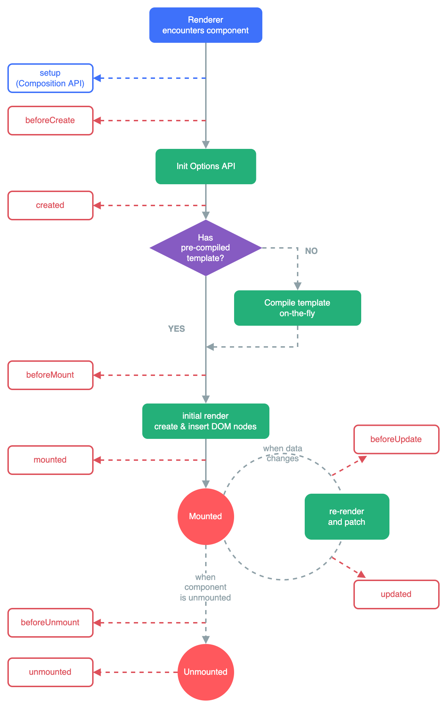
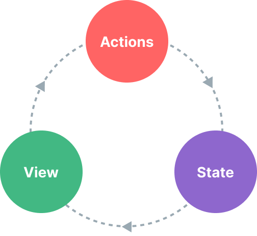
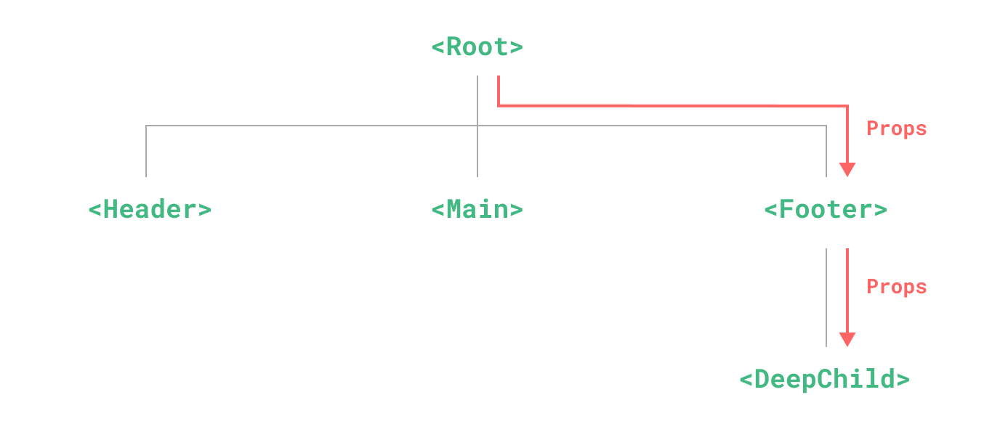
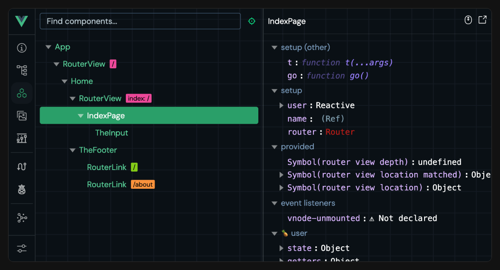

> **Uyarı:** Bu içerik, SCÜ Şarkışla UBYO Web Programlama I dersi kapsamında tamamen eğitim amaçlı çevrilmiş ve derlenmiştir. Orijinal dokümantasyon kaynakları (MDN Web Docs, Vue.js, Three.js vb.) kendi orijinal lisanslarına (CC-BY-SA, MIT) tabidir. Bu çalışmanın hiçbir ticari amacı yoktur.

# Vue.js 3 — Modül 11 Çeviri İndeksi (Render Yönetimi, Yaşam Döngüsü, Durum/State)

* **Ders:** Web Programlama I  
* **Bölüm:** SCÜ Şarkışla UBYO — Bilişim Sistemleri ve Teknolojileri  
* **Takım Adı:** gurup  
* **Modül:** 11 — Vue.js Modules (3. Takım)  
* **Modül Başlığı:** Render Yönetimi, Yaşam Döngüsü ve Durum/State (Render Management, Lifecycle & State)  
* **👥 Takım Üyeleri:**  
  * Emine Avcıbaşı ([@Emine0313](https://github.com/Emine0313))  
  * Elif Yazıcı ([@aeryhw](https://github.com/aeryhw))  
  * İbrahim Kurnaz ([@krnzibrahim](https://github.com/krnzibrahim))  

---

## 🧭 İçindekiler ve Hızlı Erişim Tablosu

Aşağıdaki tablodan çalışmamızdaki tüm konu başlıklarının **Türkçe çeviri bölümlerine**, **resmî Vue.js dokümantasyonuna** ve **MDN Web Docs kaynaklarına** doğrudan ulaşabilirsiniz:

| # | Konu Başlığı | Dosya İçi Çeviri Bölümü | Resmî Orijinal Kaynak (Vue.js / Pinia) | MDN Web Docs Kılavuzu |
|:---:|:---|:---:|:---:|:---:|
| **1** | **Koşullu Render** *(Conditional Rendering)* | [Bölüm 1'e Git](#1-koşullu-render-conditional-rendering) | [vuejs.org: Conditional Rendering](https://vuejs.org/guide/essentials/conditional.html) | [MDN: Vue Conditional Rendering](https://developer.mozilla.org/en-US/docs/Learn_web_development/Core/Frameworks_libraries/Vue_conditional_rendering) |
| **2** | **Liste Render Etme** *(List Rendering)* | [Bölüm 2'ye Git](#2-liste-render-etme-list-rendering) | [vuejs.org: List Rendering](https://vuejs.org/guide/essentials/list.html) | [MDN: Vue Rendering Lists](https://developer.mozilla.org/en-US/docs/Learn_web_development/Core/Frameworks_libraries/Vue_rendering_lists) |
| **3** | **İzleyiciler** *(Watchers & watchEffect)* | [Bölüm 3'e Git](#3-izleyiciler-watchers) | [vuejs.org: Watchers](https://vuejs.org/guide/essentials/watchers.html) | [MDN: Client-Side Frameworks Guide](https://developer.mozilla.org/en-US/docs/Learn_web_development/Core/Frameworks_libraries) |
| **4** | **Şablon Referansları** *(Template Refs)* | [Bölüm 4'e Git](#4-şablon-referansları-template-refs) | [vuejs.org: Template Refs](https://vuejs.org/guide/essentials/template-refs.html) | [MDN: Focus Management with Vue Refs](https://developer.mozilla.org/en-US/docs/Learn_web_development/Core/Frameworks_libraries/Vue_refs_focus_management) |
| **5** | **Bileşen Yaşam Döngüsü** *(Lifecycle Hooks)* | [Bölüm 5'e Git](#5-yaşam-döngüsü-kancaları-lifecycle-hooks) | [vuejs.org: Lifecycle Hooks](https://vuejs.org/guide/essentials/lifecycle.html) | [MDN: Vue Resources & Lifecycle](https://developer.mozilla.org/en-US/docs/Learn_web_development/Core/Frameworks_libraries/Vue_resources) |
| **6** | **Durum Yönetimi** *(State Management & Pinia)* | [Bölüm 6'ya Git](#6-durum-yönetimi-state-management) | [vuejs.org: State Management](https://vuejs.org/guide/scaling-up/state-management.html) & [pinia.vuejs.org](https://pinia.vuejs.org/) | [MDN: Framework Architecture & State](https://developer.mozilla.org/en-US/docs/Learn_web_development/Core/Frameworks_libraries) |

---

# 1. Koşullu Render (Conditional Rendering)

> 🌐 **Resmî Orijinal Kaynak:** [Vue.js Guide — Conditional Rendering](https://vuejs.org/guide/essentials/conditional.html)  
> ⬆️ **[İçindekiler ve Hızlı Erişim Tablosuna Dön](#-i̇çindekiler-ve-hızlı-erişim-tablosu)**

## `v-if`
`v-if` direktifi, bir bloğu koşullu olarak render etmek için kullanılır. Blok, yalnızca direktifin ifadesi gerçeğe uygun (truthy) bir değer döndürdüğünde render edilecektir:

```vue-html
<h1 v-if="awesome">Vue harikadır!</h1>
```

## `v-else`
`v-if` için bir "else (aksi halde) bloğu" belirtmek amacıyla `v-else` direktifini kullanabilirsiniz:

```vue-html
<button @click="awesome = !awesome">Durumu Değiştir</button>

<h1 v-if="awesome">Vue harikadır!</h1>
<h1 v-else>Ah hayır 😢</h1>
```

> **Kural:** Bir `v-else` öğesi, doğrudan bir `v-if` veya `v-else-if` öğesini hemen takip etmelidir; aksi takdirde Vue şablon derleyicisi tarafından tanınmaz.

## `v-else-if`
`v-else-if`, adından da anlaşılacağı gibi, `v-if` için bir "else if (aksi halde eğer)" bloğu olarak hizmet eder. Birden çok kez zincirlenebilir:

```vue-html
<div v-if="type === 'A'">A</div>
<div v-else-if="type === 'B'">B</div>
<div v-else-if="type === 'C'">C</div>
<div v-else>A/B/C değil</div>
```

`v-else` gibi, bir `v-else-if` öğesi de doğrudan bir `v-if` veya bir `v-else-if` öğesini hemen takip etmelidir.

## `<template>` Üzerinde `v-if`
Birden fazla öğeyi aynı koşula bağlamak istediğimizde görünmez bir sarıcı (wrapper) görevi gören `<template>` öğesi üzerinde `v-if` kullanabiliriz. Nihai render sonucunda `<template>` öğesi DOM'da yer almaz:

```vue-html
<template v-if="ok">
  <h1>Başlık</h1>
  <p>Paragraf 1</p>
  <p>Paragraf 2</p>
</template>
```

## `v-show`
Bir öğeyi koşullu olarak görüntülemenin bir diğer seçeneği `v-show` direktifidir. Kullanımı büyük ölçüde aynıdır:

```vue-html
<h1 v-show="ok">Merhaba!</h1>
```

Fark şudur: `v-show` içeren bir öğe her zaman render edilir ve DOM'da kalır; `v-show` yalnızca öğenin `display` CSS özelliğini açıp kapatır (`display: none`).

> **Not:** `v-show`, `<template>` öğesini desteklemez ve `v-else` ile birlikte çalışmaz.

## `v-if` ile `v-show` Karşılaştırması (Mimari Analiz)
* **`v-if` "gerçek" koşullu render'dır:** Koşullu blok içindeki olay dinleyicilerinin ve alt bileşenlerin, geçişler sırasında düzgün şekilde yok edilmesini (destroyed) ve yeniden oluşturulmasını (re-created) sağlar.
* **`v-if` tembeldir (lazy):** İlk render sırasında koşul `false` ise hiçbir işlem yapmaz; koşul ilk kez `true` olana kadar render edilmez.
* **`v-show` çok daha basittir:** Başlangıç koşulundan bağımsız olarak öğe her zaman render edilir ve yalnızca CSS tabanlı geçiş uygulanır.
* **Performans Kuralı:** Sık açılıp kapanan elemanlarda `v-show` (düşük geçiş maliyeti); koşulun nadiren değiştiği durumlarda `v-if` (düşük başlangıç render maliyeti) tercih edilir.

## `v-if` ile `v-for` Birlikte Kullanımı
> ⚠️ **Uyarı:** `v-if` ve `v-for`'un aynı öğe üzerinde birlikte kullanılması önerilmez.  
> Aynı öğede kullanıldığında `v-if` daha yüksek önceliğe sahiptir; bu nedenle `v-for` döngüsündeki değişkenlere erişemez. Bunun yerine `<template v-for>` veya `computed()` ile filtreleme yapılmalıdır.

---

# 2. Liste Render Etme (List Rendering)

> 🌐 **Resmî Orijinal Kaynak:** [Vue.js Guide — List Rendering](https://vuejs.org/guide/essentials/list.html)  
> ⬆️ **[İçindekiler ve Hızlı Erişim Tablosuna Dön](#-i̇çindekiler-ve-hızlı-erişim-tablosu)**

## `v-for` ile Dizi Render Etme
Bir diziye dayalı bir öğe listesini render etmek için `item in items` biçiminde `v-for` kullanılır:

```vue-html
<li v-for="(item, index) in items" :key="item.id">
  {{ parentMessage }} - {{ index }} - {{ item.message }}
</li>
```

`in` yerine sınırlayıcı olarak `of` da kullanabilirsiniz; bu JavaScript'in yineleyiciler (iterators) sözdizimine daha yakındır:

```vue-html
<div v-for="item of items" :key="item.id"></div>
```

## `v-for` ile Nesne (Object) Render Etme
Bir nesnenin özelliklerini yinelemek için:

```vue-html
<li v-for="(value, key, index) in myObject" :key="key">
  {{ index }}. {{ key }}: {{ value }}
</li>
```

## Sayı Aralığı ile `v-for`
`v-for` tam sayıları da kabul eder (`1...n` aralığı, 1'den başlar):

```vue-html
<span v-for="n in 10" :key="n">{{ n }} </span>
```

## `key` ile Durumu Koruma (Maintaining State with `key`)
Vue varsayılan olarak **"yerinde yama" (in-place patch)** stratejisi kullanır. Öğelerin sırası değiştiğinde DOM elemanlarını taşımak yerine yerinde günceller.  
Alt bileşen durumunu ve form elemanlarının değerini korumak için her öğeye benzersiz ve kararlı bir `key` özniteliği sağlanmalıdır:

```vue-html
<div v-for="item in items" :key="item.id">
  <!-- içerik -->
</div>
```

## Dizi Değişiklik Algılama (Array Change Detection)
* **Mutasyon Metotları (DOM güncellemesini otomatik tetikler):** `push()`, `pop()`, `shift()`, `unshift()`, `splice()`, `sort()`, `reverse()`
* **Diziyi Değiştirme (Yeni Dizi Döndürenler):** `filter()`, `concat()`, `slice()`. Eski diziyi yenisiyle değiştirmelisiniz (`items.value = items.value.filter(...)`).

---

# 3. İzleyiciler (Watchers)

> 🌐 **Resmî Orijinal Kaynak:** [Vue.js Guide — Watchers](https://vuejs.org/guide/essentials/watchers.html)  
> ⬆️ **[İçindekiler ve Hızlı Erişim Tablosuna Dön](#-i̇çindekiler-ve-hızlı-erişim-tablosu)**

## Temel Örnek
Reaktif durum değişikliklerine yanıt olarak yan etkiler (DOM değiştirme, API çağrısı, localStorage yazma) yürütmek için `watch` fonksiyonu kullanılır:

```vue
<script setup>
import { ref, watch } from 'vue'

const question = ref('')
const answer = ref('Sorular genellikle soru işareti (?) içerir.')
const loading = ref(false)

watch(question, async (newQuestion) => {
  if (newQuestion.includes('?')) {
    loading.value = true
    try {
      const res = await fetch('https://yesno.wtf/api')
      answer.value = (await res.json()).answer
    } finally {
      loading.value = false
    }
  }
})
</script>

<template>
  <p>Evet/hayır sorusu sorun: <input v-model="question" :disabled="loading" /></p>
  <p>{{ answer }}</p>
</template>
```

## İzleme Kaynağı Türleri
1. Bir `ref`
2. Bir reaktif nesne
3. Bir getter fonksiyonu (`() => obj.count`)
4. Birden çok kaynağın dizisi (`[x, () => y.value]`)

```js
// Getter fonksiyonu ile tek bir reaktif özelliği izleme
watch(
  () => obj.count,
  (count) => { console.log(`Yeni count: ${count}`) }
)
```

## Derin İzleyiciler (Deep Watchers)
Reaktif bir nesne doğrudan izlendiğinde otomatik derin moddadır. Getter fonksiyonlarında `{ deep: true }` seçeneği eklenmelidir:

```js
watch(
  () => state.someObject,
  (newVal) => { /* içteki değişikliklerde çalışır */ },
  { deep: true }
)
```

## `watchEffect()`
`watchEffect()`, yürütme sırasında erişilen her reaktif özelliği **otomatik olarak takip eder**:

```js
const todoId = ref(1)
const data = ref(null)

watchEffect(async () => {
  const response = await fetch(`https://jsonplaceholder.typicode.com/todos/${todoId.value}`)
  data.value = await response.json()
})
```

---

# 4. Şablon Referansları (Template Refs)

> 🌐 **Resmî Orijinal Kaynak:** [Vue.js Guide — Template Refs](https://vuejs.org/guide/essentials/template-refs.html)  
> ⬆️ **[İçindekiler ve Hızlı Erişim Tablosuna Dön](#-i̇çindekiler-ve-hızlı-erişim-tablosu)**

Doğrudan ham DOM öğelerine erişmek (input'a odaklanmak veya öğe boyutunu ölçmek) için `ref` özniteliği kullanılır:

```vue
<script setup>
import { ref, onMounted } from 'vue'

// Şablondaki ref="input" ile aynı ad
const input = ref(null)

onMounted(() => {
  // Yalnızca bileşen DOM'a bağlandıktan sonra doludur!
  input.value.focus()
})
</script>

<template>
  <input ref="input" />
</template>
```

## `v-for` İçinde Referanslar
`v-for` içinde `ref` kullanıldığında, karşılık gelen referans değeri bileşen bağlandıktan sonra DOM öğelerini içeren bir dizi haline gelir:

```vue
<script setup>
import { ref, onMounted } from 'vue'

const list = ref(['Öğe 1', 'Öğe 2', 'Öğe 3'])
const itemRefs = ref([])

onMounted(() => {
  console.log(itemRefs.value) // DOM <li> öğelerini içeren dizi
})
</script>

<template>
  <ul>
    <li v-for="item in list" :key="item" ref="itemRefs">
      {{ item }}
    </li>
  </ul>
</template>
```

## Bileşen Üzerinde Referans & `defineExpose`
`<script setup>` kullanan alt bileşenler varsayılan olarak kapalıdır. Ebeveynin ref üzerinden erişebilmesi için `defineExpose` kullanılmalıdır:

```vue
<!-- Child.vue -->
<script setup>
import { ref } from 'vue'
const count = ref(0)
defineExpose({ count })
</script>
```

---

# 5. Yaşam Döngüsü Kancaları (Lifecycle Hooks)

> 🌐 **Resmî Orijinal Kaynak:** [Vue.js Guide — Lifecycle Hooks](https://vuejs.org/guide/essentials/lifecycle.html)  
> ⬆️ **[İçindekiler ve Hızlı Erişim Tablosuna Dön](#-i̇çindekiler-ve-hızlı-erişim-tablosu)**

Bileşenin oluşturulma, montaj, güncelleme ve yok edilme süreçlerinde kendi kodumuzu çalıştırmamızı sağlar.

## Yaşam Döngüsü Kancalarını Kaydetme
```vue
<script setup>
import { onMounted, onUpdated, onUnmounted } from 'vue'

onMounted(() => {
  console.log('Bileşen DOM üzerinde render edildi.')
})

onUnmounted(() => {
  console.log('Bileşen söküldü, zamanlayıcılar temizlendi.')
})
</script>
```

> **Önemli Kural:** Yaşam döngüsü kancaları bileşen kurulumu sırasında **senkron olarak** kaydedilmelidir (asla `setTimeout` içinde çağrılamaz).

## Yaşam Döngüsü Diyagramı (Lifecycle Diagram)
Aşağıda bir Vue bileşeninin tüm yaşam döngüsü ve tetiklenen kancalar resmi diyagramda gösterilmektedir:



---

# 6. Durum Yönetimi (State Management & Pinia)

> 🌐 **Resmî Orijinal Kaynak:** [Vue.js Guide — State Management](https://vuejs.org/guide/scaling-up/state-management.html) & [Pinia Resmî Dokümantasyonu](https://pinia.vuejs.org/)  
> ⬆️ **[İçindekiler ve Hızlı Erişim Tablosuna Dön](#-i̇çindekiler-ve-hızlı-erişim-tablosu)**

## Durum Yönetimi Nedir?
Her Vue bileşeni kendi reaktif durumunu yönetir:
* **State (Durum):** Uygulamayı yönlendiren veri kaynağıdır.
* **View (Görünüm):** Durumun şablon üzerindeki bildirimsel haritalamasıdır.
* **Actions (Eylemler):** Kullanıcı etkileşimiyle durumu güncelleyen metotlardır.

### Tek Yönlü Veri Akışı Diyagramı
<p align="center">
  
</p>

## Paylaşılan Durum ve Prop Drilling Problemi
Birden fazla bileşen aynı veriyi paylaştığında, veriyi yukarı taşıyıp props ile aşağı iletmek **Prop Drilling** krizine yol açar:

<p align="center">
  
</p>

### Çözüm: Global Singleton Store
Paylaşılan durumu bileşen ağacının dışına çıkarmak ve tekil bir merkezde yönetmek.

## Pinia: Resmi Durum Yönetimi Kütüphanesi
Pinia, modern Vue ekosisteminin resmi durum yönetim kütüphanesidir ve eski **Vuex**'in yerini almıştır.

<p align="center">
  
</p>

### Pinia Setup Store Tanımlama ve Kullanma
```js
// src/stores/counter.js
import { defineStore } from 'pinia'
import { ref, computed } from 'vue'

export const useCounterStore = defineStore('counter', () => {
  const count = ref(0)
  const doubleCount = computed(() => count.value * 2)
  function increment() { count.value++ }
  return { count, doubleCount, increment }
})
```

```vue
<!-- Component.vue -->
<script setup>
import { useCounterStore } from '@/stores/counter'
import { storeToRefs } from 'pinia'

const store = useCounterStore()
// Reaktiviteyi koruyarak parçalama:
const { count, doubleCount } = storeToRefs(store)
const { increment } = store
</script>

<template>
  <button @click="increment">Sayaç: {{ count }} (2 Katı: {{ doubleCount }})</button>
</template>
```

### Pinia'nın Avantajları:
1. **Mutations Yoktur:** State doğrudan actions içinde güncellenir.
2. **Setup Store Sözdizimi:** `<script setup>` ile birebir aynı yapıda modern reaktif mağazalar tanımlanır.
3. **Mükemmel TypeScript Desteği:** Otomatik tip çıkarımı sağlar.
4. **`storeToRefs()` ile Reaktivite Koruma:** State parçalanırken reaktivite kaybını önler.
